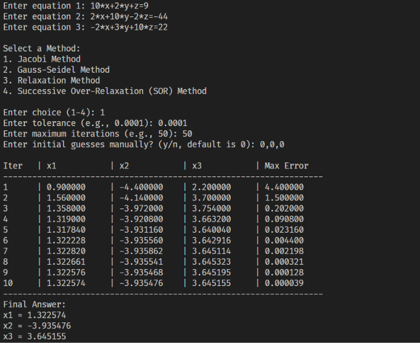
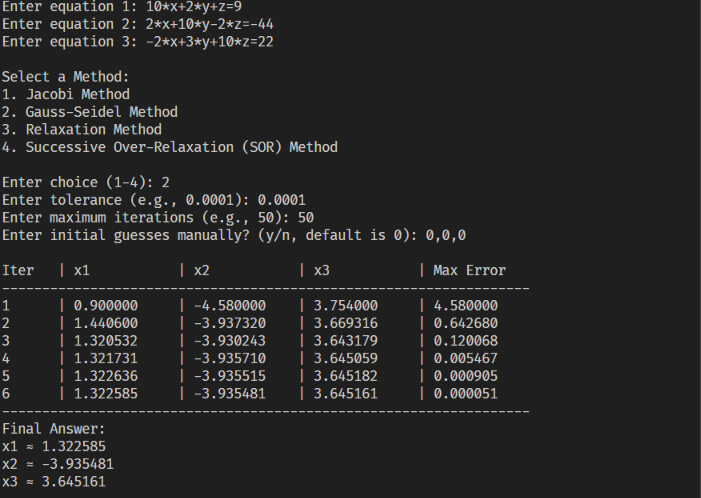
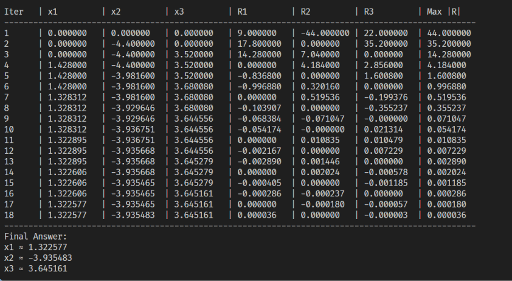
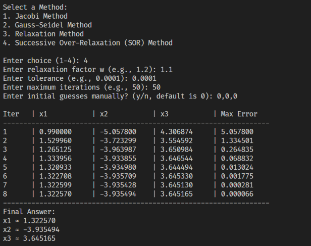

# Linear System Iterative Solver in Python

## 1. Project Overview

This project provides a command-line program in Python to solve systems of $n \times n$ linear algebraic equations of the form $AX = b$. The user can dynamically enter any system of linear equations and choose from four classical iterative numerical methods. The program outputs a formatted step-by-step iteration table showing the variable values at each step, the current error or residuals, and the final approximate solution vector.

## -- Github Repository
[Repository](https://github.com/eng-mahmoud-awad/Numerical-Methods-2)

## 2. Supported Iterative Methods

For a system of $n$ linear equations where $a_{ii} \neq 0$:

$$
\sum_{j=1}^{n} a_{ij} x_j = b_i \quad (i = 1, 2, \dots, n)
$$

### 2.1 Jacobi Method

Computes the next approximation $x_i^{(k+1)}$ using solely the values from the previous iteration $x^{(k)}$:

$$
x_i^{(k+1)} = \frac{1}{a_{ii}} \left( b_i - \sum_{j=1, j \neq i}^{n} a_{ij} x_j^{(k)} \right)
$$

### 2.2 Gauss-Seidel Method

Uses the most recently updated values $x_j^{(k+1)}$ immediately as they become available within the same iteration step:

$$
x_i^{(k+1)} = \frac{1}{a_{ii}} \left( b_i - \sum_{j=1}^{i-1} a_{ij} x_j^{(k+1)} - \sum_{j=i+1}^{n} a_{ij} x_j^{(k)} \right)
$$

### 2.3 Relaxation Method (Southwell Residual Method)

At each iteration, computes the residual vector $R^{(k)}$:

$$
R_i^{(k)} = b_i - \sum_{j=1}^{n} a_{ij} x_j^{(k)}
$$

Identifies the variable index $m$ corresponding to the largest residual in magnitude ($|R_m^{(k)}| = \max_i |R_i^{(k)}|$) and updates that variable:

$$
x_m^{(k+1)} = x_m^{(k)} + \frac{R_m^{(k)}}{a_{mm}}
$$

### 2.4 Successive Over-Relaxation (SOR) Method

Accelerates the convergence of the Gauss-Seidel method by applying a relaxation factor $\omega$ ($1 < \omega < 2$ for over-relaxation):

$$
x_i^{(k+1)} = (1 - \omega) x_i^{(k)} + \frac{\omega}{a_{ii}} \left( b_i - \sum_{j=1}^{i-1} a_{ij} x_j^{(k+1)} - \sum_{j=i+1}^{n} a_{ij} x_j^{(k)} \right)
$$

## 3. How to Run the Program

1. Ensure **Python 3.x** is installed on your system.
2. Open the project folder in **Visual Studio Code**.
3. Open `linear_system.py` and run it via the **Run (Play)** button or by executing the following command in the terminal:

   ```bash
   python linear_system.py
   ```

4. Follow the prompts to enter the number of equations, the equations themselves, the desired method, tolerance, and maximum iterations.

## 4. Python Source Code (`linear_system.py`)

```python
from math import *

# Helper function to evaluate linear equations and extract matrix A and vector b
def parse_linear_equations(equations, n):
    var_names = ['x', 'y', 'z', 'w']
    A = []
    b = []
    
    for eq in equations:
        eq = eq.replace('^', '**')
        if '=' in eq:
            lhs, rhs = eq.split('=')
            expr = f"({lhs}) - ({rhs})"
        else:
            expr = eq
            
        # Evaluate at all zeros to find -b_i
        env_zero = {f"x{j+1}": 0.0 for j in range(n)}
        for j in range(min(n, 4)):
            env_zero[var_names[j]] = 0.0
        b_i = -eval(expr, {"__builtins__": None}, env_zero)
        b.append(b_i)
        
        # Evaluate at unit vectors to find coefficients a_ij
        row = []
        for j in range(n):
            env_unit = env_zero.copy()
            env_unit[f"x{j+1}"] = 1.0
            if j < 4:
                env_unit[var_names[j]] = 1.0
            a_ij = eval(expr, {"__builtins__": None}, env_unit) + b_i
            row.append(a_ij)
        A.append(row)
        
    return A, b

def main():
    print("=== Linear System Iterative Solver ===")
    print("Tip: Write equations using x, y, z OR x1, x2, x3 (e.g., 10*x + 2*y - z = 27)")
    
    n = int(input("\nEnter number of equations (n): "))
    equations = []
    for i in range(n):
        eq = input(f"Enter equation {i+1}: ")
        equations.append(eq)
        
    A, b = parse_linear_equations(equations, n)
    
    print("\nSelect a Method:")
    print("1. Jacobi Method")
    print("2. Gauss-Seidel Method")
    print("3. Relaxation Method")
    print("4. Successive Over-Relaxation (SOR) Method")
    
    choice = input("\nEnter choice (1-4): ").strip()
    
    omega = 1.0
    if choice == '4':
        omega = float(input("Enter relaxation factor w (e.g., 1.2): "))
        
    tol = float(input("Enter tolerance (e.g., 0.0001): "))
    max_iter = int(input("Enter maximum iterations (e.g., 50): "))
    
    x = [0.0] * n
    init_choice = input("Enter initial guesses manually? (y/n, default is 0): ").strip().lower()
    if init_choice == 'y':
        for i in range(n):
            x[i] = float(input(f"Enter initial guess x{i+1}^(0): "))

    # 1. JACOBI, 2. GAUSS-SEIDEL & 4. SOR METHODS
    if choice in ['1', '2', '4']:
        header = f"{'Iter':<6} | " + " | ".join([f"{'x'+str(i+1):<12}" for i in range(n)]) + f" | {'Max Error':<12}"
        print("\n" + header)
        print("-" * len(header))
        
        for k in range(1, max_iter + 1):
            x_old = x.copy()
            x_new = x.copy()
            
            for i in range(n):
                if choice == '1':
                    sigma = sum(A[i][j] * x_old[j] for j in range(n) if j != i)
                    x_new[i] = (b[i] - sigma) / A[i][i]
                elif choice == '2':
                    sigma = sum(A[i][j] * x_new[j] for j in range(n) if j != i)
                    x_new[i] = (b[i] - sigma) / A[i][i]
                elif choice == '4':
                    sigma = sum(A[i][j] * x_new[j] for j in range(n) if j != i)
                    gs_val = (b[i] - sigma) / A[i][i]
                    x_new[i] = (1 - omega) * x_old[i] + omega * gs_val
                    
            error = max(abs(x_new[i] - x_old[i]) for i in range(n))
            x = x_new
            
            row_str = f"{k:<6} | " + " | ".join([f"{val:<12.6f}" for val in x]) + f" | {error:<12.6f}"
            print(row_str)
            
            if error < tol:
                break
                
        print("-" * len(header))
        print("Final Answer:")
        for i in range(n):
            print(f"x{i+1} = {x[i]:.6f}")

    # 3. RELAXATION METHOD
    elif choice == '3':
        header = (f"{'Iter':<6} | " + 
                  " | ".join([f"{'x'+str(i+1):<10}" for i in range(n)]) + " | " +
                  " | ".join([f"{'R'+str(i+1):<10}" for i in range(n)]) + f" | {'Max |R|':<10}")
        print("\n" + header)
        print("-" * len(header))
        
        for k in range(1, max_iter + 1):
            R = [b[i] - sum(A[i][j] * x[j] for j in range(n)) for i in range(n)]
            max_r = max(abs(r) for r in R)
            
            row_str = (f"{k:<6} | " + 
                       " | ".join([f"{val:<10.6f}" for val in x]) + " | " +
                       " | ".join([f"{r:<10.6f}" for r in R]) + f" | {max_r:<10.6f}")
            print(row_str)
            
            if max_r < tol:
                break
                
            idx = max(range(n), key=lambda i: abs(R[i]))
            dx = R[idx] / A[idx][idx]
            x[idx] += dx
            
        print("-" * len(header))
        print("Final Answer:")
        for i in range(n):
            print(f"x{i+1} = {x[i]:.6f}")

    else:
        print("Invalid choice! Please select a number between 1 and 4.")

if __name__ == "__main__":
    main()
```

## 5. Program Output & Screenshots

Below are the test results for solving the $3 \times 3$ diagonally dominant linear system:

$$
\begin{aligned}
10x + 2y + z &= 9 \\
2x + 20y - 2z &= -44 \\
-2x + 3y + 10z &= 22
\end{aligned}
$$

with initial guesses $x^{(0)} = (0, 0, 0)$, tolerance $0.0001$, and maximum iterations $50$.


### 5.1 Jacobi Method Output

* **Inputs:** Method `1`, Initial guesses `(0, 0, 0)`
* **Screenshot:**

  

### 5.2 Gauss-Seidel Method Output

* **Inputs:** Method `2`, Initial guesses `(0, 0, 0)`
* **Screenshot:**

  

### 5.3 Relaxation Method Output

* **Inputs:** Method `3`, Initial guesses `(0, 0, 0)`
* **Screenshot:**

  

### 5.4 Successive Over-Relaxation (SOR) Method Output

* **Inputs:** Method `4`, $\omega = 1.1$, Initial guesses `(0, 0, 0)`
* **Screenshot:**

  