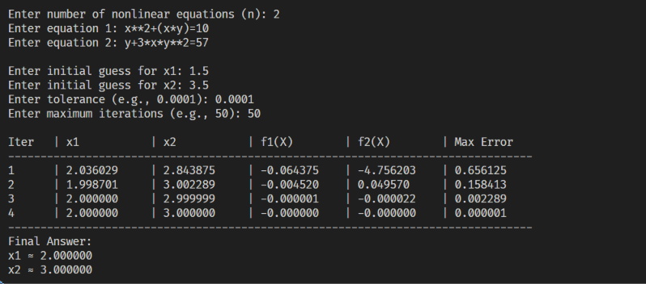

# Nonlinear System Solver (Newton-Raphson Method) in Python

## 1. Project Overview

This project provides a command-line program in Python to solve systems of $n$ nonlinear algebraic equations with $n$ unknowns using the **Multivariable Newton-Raphson Method**. The program allows the user to input nonlinear equations symbolically, computes the Jacobian matrix numerically at each step, solves the linear increment system via Gaussian Elimination with partial pivoting, and prints a formatted iteration table with the final root vector.

## -- Github Repository
[Repository](https://github.com/eng-mahmoud-awad/Numerical-Methods-2)

## 2. Mathematical Formulation

Given a system of $n$ nonlinear equations:

$$
F(X) = \begin{bmatrix} f_1(x_1, x_2, \dots, x_n) \\ f_2(x_1, x_2, \dots, x_n) \\ \vdots \\ f_n(x_1, x_2, \dots, x_n) \end{bmatrix} = \begin{bmatrix} 0 \\ 0 \\ \vdots \\ 0 \end{bmatrix}
$$

### 2.1 The Jacobian Matrix

At each iteration $k$, the $n \times n$ Jacobian matrix $J(X^{(k)})$ of partial derivatives is constructed:

$$
J(X) = \begin{bmatrix}
\frac{\partial f_1}{\partial x_1} & \frac{\partial f_1}{\partial x_2} & \cdots & \frac{\partial f_1}{\partial x_n} \\
\frac{\partial f_2}{\partial x_1} & \frac{\partial f_2}{\partial x_2} & \cdots & \frac{\partial f_2}{\partial x_n} \\
\vdots & \vdots & \ddots & \vdots \\
\frac{\partial f_n}{\partial x_1} & \frac{\partial f_n}{\partial x_2} & \cdots & \frac{\partial f_n}{\partial x_n}
\end{bmatrix}
$$

Each partial derivative is approximated numerically using finite differences:

$$
\frac{\partial f_i}{\partial x_j} \approx \frac{f_i(x_1, \dots, x_j + h, \dots, x_n) - f_i(x_1, \dots, x_j, \dots, x_n)}{h}
$$

### 2.2 Newton-Raphson Iteration Step

Instead of inverting the Jacobian matrix directly, the program solves the linear system for the correction vector $\Delta X^{(k)}$:

$$
J(X^{(k)}) \cdot \Delta X^{(k)} = -F(X^{(k)})
$$

The solution vector is then updated as:

$$
X^{(k+1)} = X^{(k)} + \Delta X^{(k)}
$$

Iteration continues until the maximum absolute correction satisfies $\max_i |\Delta x_i^{(k)}| < \text{tolerance}$.

## 3. How to Run the Program

1. Ensure **Python 3.x** is installed on your system.
2. Open the project folder in **Visual Studio Code**.
3. Open `nonlinear_system.py` and run it via the **Run (Play)** button or by executing the following command in the terminal:

   ```bash
   python nonlinear_system.py
   ```

4. Follow the prompts to enter the number of nonlinear equations, the equations, initial guesses, tolerance, and maximum iterations.

## 4. Python Source Code (`nonlinear_system.py`)

```python
from math import *

# Evaluate a nonlinear expression at point X = [x1, x2, ...]
def evaluate_func(expr, X):
    var_names = ['x', 'y', 'z', 'w']
    env = {k: v for k, v in globals().items() if not k.startswith("__")}
    for i, val in enumerate(X):
        env[f"x{i+1}"] = val
        if i < 4:
            env[var_names[i]] = val
    return eval(expr, {"__builtins__": None}, env)

# Compute the Jacobian matrix numerically: J_ij = df_i / dx_j
def compute_jacobian(funcs, X, h=1e-6):
    n = len(X)
    J = [[0.0] * n for _ in range(n)]
    for i in range(n):
        f_base = evaluate_func(funcs[i], X)
        for j in range(n):
            X_step = X.copy()
            X_step[j] += h
            J[i][j] = (evaluate_func(funcs[i], X_step) - f_base) / h
    return J

# Solve linear system J * dX = rhs using Gaussian Elimination
def solve_linear(J, rhs):
    n = len(rhs)
    M = [J[i][:] + [rhs[i]] for i in range(n)]
    
    for i in range(n):
        # Partial pivoting
        max_row = max(range(i, n), key=lambda r: abs(M[r][i]))
        M[i], M[max_row] = M[max_row], M[i]
        
        if abs(M[i][i]) < 1e-12:
            raise ValueError("Jacobian matrix is singular (division by zero).")
            
        for k in range(i + 1, n):
            factor = M[k][i] / M[i][i]
            for j in range(i, n + 1):
                M[k][j] -= factor * M[i][j]
                
    dX = [0.0] * n
    for i in range(n - 1, -1, -1):
        dX[i] = (M[i][n] - sum(M[i][j] * dX[j] for j in range(i + 1, n))) / M[i][i]
    return dX

def main():
    print("=== Nonlinear System Solver (Newton-Raphson Method) ===")
    print("Tip: Write equations using x, y, z OR x1, x2, x3 (e.g., x^2 + y^2 = 4)")
    
    n = int(input("\nEnter number of nonlinear equations (n): "))
    funcs = []
    for i in range(n):
        eq = input(f"Enter equation {i+1}: ").replace('^', '**')
        if '=' in eq:
            lhs, rhs = eq.split('=')
            funcs.append(f"({lhs}) - ({rhs})")
        else:
            funcs.append(eq)
            
    X = []
    print()
    for i in range(n):
        X.append(float(input(f"Enter initial guess for x{i+1}: ")))
        
    tol = float(input("Enter tolerance (e.g., 0.0001): "))
    max_iter = int(input("Enter maximum iterations (e.g., 50): "))
    
    header = (f"{'Iter':<6} | " + 
              " | ".join([f"{'x'+str(i+1):<12}" for i in range(n)]) + " | " +
              " | ".join([f"{'f'+str(i+1)+'(X)':<12}" for i in range(n)]) + f" | {'Max Error':<12}")
    print("\n" + header)
    print("-" * len(header))
    
    for k in range(1, max_iter + 1):
        F = [evaluate_func(funcs[i], X) for i in range(n)]
        J = compute_jacobian(funcs, X)
        
        try:
            dX = solve_linear(J, [-f for f in F])
        except ValueError as e:
            print(f"Error: {e}")
            return
            
        X = [X[i] + dX[i] for i in range(n)]
        F_new = [evaluate_func(funcs[i], X) for i in range(n)]
        error = max(abs(dx) for dx in dX)
        
        row_str = (f"{k:<6} | " + 
                   " | ".join([f"{val:<12.6f}" for val in X]) + " | " +
                   " | ".join([f"{f_val:<12.6f}" for f_val in F_new]) + f" | {error:<12.6f}")
        print(row_str)
        
        if error < tol:
            break
            
    print("-" * len(header))
    print("Final Answer:")
    for i in range(n):
        print(f"x{i+1} = {X[i]:.6f}")

if __name__ == "__main__":
    main()
```

## 5. Program Output & Screenshots

Below are the test results for solving the $2 \times 2$ nonlinear system:

$$
\begin{aligned}
x^2 + xy &= 10 \\
y + 3xy^2 &= 57
\end{aligned}
$$

with initial guesses $x_1^{(0)} = 1.5$, $x_2^{(0)} = 3.5$, tolerance $0.0001$, and maximum iterations $50$.


### 5.1 Multivariable Newton-Raphson Output

* **Inputs:**
  * Equation 1: `x^2 + x*y = 10`
  * Equation 2: `y + 3*x*y^2 = 57`
  * Initial guesses: `x1 = 1.5`, `x2 = 3.5`
* **Screenshot:**

  